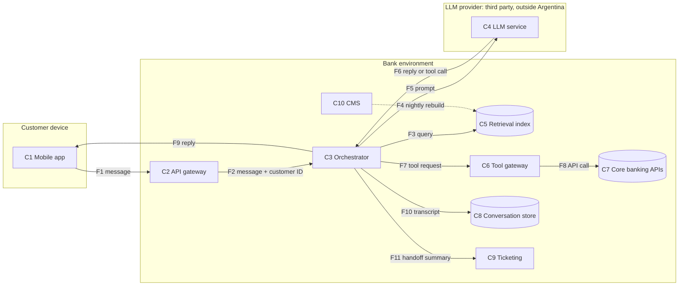

# 01 · System characterization

> **Fictional case.** Acme Digital Bank and its assistant do not exist. The design choices below are deliberate inputs for the assessment, not recommendations.

## 1. Organization

Acme Digital Bank (the Bank) is a fictional Argentine digital bank, authorized and supervised by the BCRA as a financial entity. It serves retail customers through its mobile app only. Its products are peso savings and checking accounts, debit cards, instant transfers and bill payments.

## 2. System under assessment

**Acme Assistant** is a generative AI chat assistant embedded in the mobile app. It is available 24/7, in Spanish, to customers who are already logged in.

| Capability | Type | Description |
|---|---|---|
| Answer product and fee questions | Read, public data | Answers from passages retrieved from the public help center and the product terms. |
| Explain recent transactions | Read, customer data | Retrieves the customer's transactions from the last 30 days and explains them in plain language. |
| Freeze a debit card | Write, customer account | Temporarily freezes one of the customer's own debit cards when the customer asks for it. |
| Hand off to a human | Write, support system | Opens a support ticket with a summary of the conversation and routes the chat to an agent. |

By design the assistant cannot make transfers or payments, change limits, change personal or contact data, or unfreeze a card. Unfreezing is only possible from the card settings screen of the app, with biometric confirmation.

The assistant does not take credit, pricing or fraud decisions.

## 3. Actors

| Actor | Role |
|---|---|
| Customer | Logged-in retail customer using the chat. |
| Support agent | Bank employee who receives handoffs and reads summaries and transcripts. |
| Content team | Writes and publishes help center articles and product terms in the content management system (CMS). |
| AI platform team | Owns the system prompt, tool definitions, retrieval configuration and releases. |
| LLM provider | Third party that hosts the language model and its content filter, reached through an API. |

## 4. Architecture

| ID | Component | Description |
|---|---|---|
| C1 | Mobile app (chat UI) | Renders assistant replies as Markdown, including links. |
| C2 | API gateway | Authenticates the app session and forwards chat requests with the customer ID. |
| C3 | Assistant orchestrator | Bank-owned service. Builds each prompt from the system prompt, the conversation history, retrieved passages and tool results; calls the model; validates and executes tool calls; logs the conversation. |
| C4 | LLM service | Third-party hosted model with a built-in content filter, running in the provider's cloud region outside Argentina. |
| C5 | Retrieval index | Vector index of help center articles and product terms, rebuilt every night from the CMS. |
| C6 | Tool gateway | Turns tool calls into core banking API requests, using a single service credential. |
| C7 | Core banking APIs | Systems of record for accounts, transactions and cards. |
| C8 | Conversation store | Full transcripts, tool results included, kept for 12 months for quality review and customer disputes. Readable by support and by the AI platform team. |
| C9 | Ticketing system | Receives handoffs with a summary of the conversation written by the model. |
| C10 | CMS | Source of the help center content. |

### Data flow

| Flow | Description |
|---|---|
| F1–F2 | The customer's message reaches the orchestrator with the customer ID taken from the authenticated session, never from the message itself. |
| F3 | For product questions the orchestrator retrieves the most relevant passages from the index. |
| F4 | Every night the index is rebuilt from the CMS. Any published article is indexed automatically. |
| F5–F6 | The orchestrator sends the full prompt to the LLM service, which returns either a reply or a tool call. |
| F7–F8 | The orchestrator overwrites any customer ID in the tool call with the one from the session, checks that the card belongs to that customer and executes the call through the tool gateway. The result is added to the prompt and the model is called again. |
| F9 | The reply goes through the provider's output filter and is rendered in the app as Markdown. |
| F10–F11 | The whole conversation, tool results included, is stored. On handoff the model writes a summary for the agent. |

### Design decisions relevant to the assessment

1. Transactions are passed to the model as the core API returns them, including the free-text description written by whoever sent the transfer.
2. Before freezing a card the assistant asks the customer to confirm in the chat. A "yes" in the conversation counts as confirmation, and it is the model that decides whether confirmation was given.
3. The tool gateway uses one service credential with read access to transactions and write access to card status. Customer scoping is enforced by the orchestrator (flow F7), not by the core APIs.
4. The system prompt holds the assistant's rules, the tool definitions and the internal escalation criteria.
5. Articles published in the CMS reach the index without any review specific to the assistant.
6. Input and output filtering rely on the provider's built-in filter. The Bank adds no filter of its own.
7. There is no per-customer limit on messages or tokens.

## 5. Data

| ID | Data | Where it appears | Classification |
|---|---|---|---|
| D1 | Customer ID and name | C2, C3, C4, C8 | Personal data |
| D2 | Transactions: amount, date, counterparty, description | C3, C4, C8 | Personal data under financial secrecy |
| D3 | Card references: last four digits and status | C3, C4, C8 | Personal data. Full card numbers and security codes never enter the prompt. |
| D4 | Conversation content, including anything the customer volunteers | C3, C4, C8, C9 | Personal data, possibly sensitive |
| D5 | Help center articles and product terms | C4, C5, C10 | Public |
| D6 | System prompt, tool definitions, escalation criteria | C3, C4 | Internal |
| D7 | Handoff summaries | C9 | Personal data |

## 6. Trust boundaries

| ID | Boundary | Why it matters |
|---|---|---|
| TB1 | Customer device ↔ Bank | Customer input is untrusted. |
| TB2 | Bank ↔ LLM provider | Personal data under financial secrecy leaves the Bank and the country, and the model's behavior depends on a third party. |
| TB3 | Orchestrator ↔ core banking | The only path by which model output can change a customer's account. |
| TB4 | CMS ↔ retrieval index | Content written for people becomes input for the model. |

Inside the prompt, the Bank's own instructions sit next to three kinds of content it does not control: the customer's messages, retrieved passages and tool results. Transfer descriptions (D2) are written by third parties, so anyone who sends a transfer to a customer can put text in front of the model.

## 7. Regulatory context (Argentina)

| Instrument | Relevance |
|---|---|
| BCRA AI supervision guide (June 2026) | Supervisory expectations on AI governance and risk management, data, model development, validation and monitoring, bias and explainability, cybersecurity, continuity, outsourcing and transparency. It is meant to be applied together with the BCRA minimum requirements on technology and information security risk. |
| BCRA minimum requirements on technology and information security risk | Information security baseline that the assistant inherits from the Bank. |
| Ley 25.326 | Processing of customers' personal data, including its international transfer to the provider (art. 12). |
| Ley 21.526, art. 39 | Financial secrecy over deposit operations, relevant to flows F5, F10 and F11. |

This section frames the assessment. It is not a legal opinion.

## 8. Assumptions

- The provider has committed by contract not to use API data to train its models. This is to be verified in the outsourcing review.
- App authentication, session management and the core banking APIs are secure. They are out of scope except where they meet the assistant.
- The model is a general-purpose model used through the provider's API, without fine-tuning.
